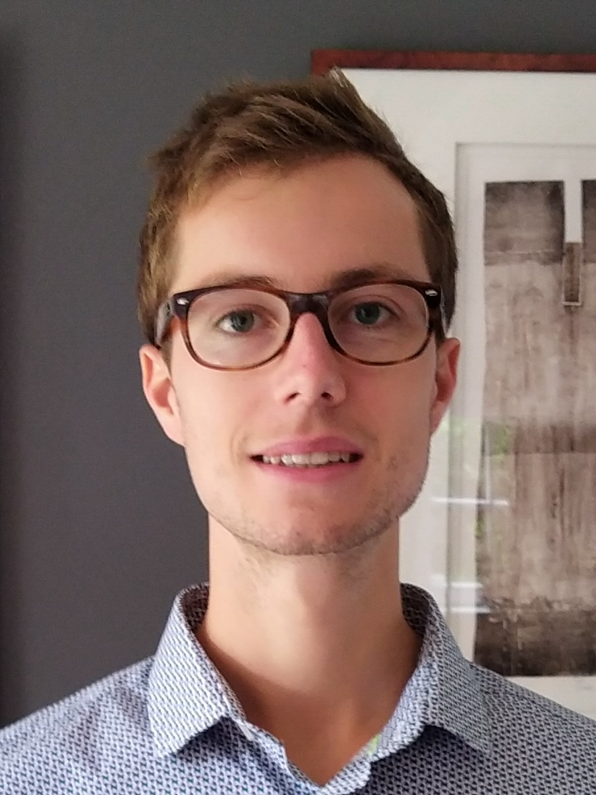

+++
title = "Guillaume Berger"
[params]
subtitle = "At Octave.energy · Former FNRS Postdoctoral Researcher at UCLouvain"
+++

# Guillaume Berger

  

    
    
    
  

**Data Scientist at [Octave.energy](https://octave.energy/)**\
Former FNRS Postdoctoral Researcher at UCLouvain

## About

<!-- raw html to allow a responsive row  -->

    

I work at [Octave.energy](https://octave.energy/), with a background in the analysis, control, and optimization of cyber-physical systems.
Previously, I was an [FNRS](https://www.frs-fnrs.be/en/) postdoctoral fellow at [UCLouvain](https://uclouvain.be/en/index.html) in the team of [Raphaël Jungers](https://perso.uclouvain.be/raphael.jungers/content/home), and a postdoctoral researcher at the [University of Colorado Boulder](https://www.colorado.edu/) in the team of [Sriram Sankaranarayanan](https://home.cs.colorado.edu/~srirams/).

My research focuses on formal verification and data-driven analysis and control of complex systems, particularly cyber-physical and hybrid systems.
I combine tools from optimization, computer science, and machine learning to study safety and correctness guarantees.

I have taught undergraduate, master’s, and graduate courses at the University of Colorado Boulder, UCLouvain, and UNamur, and have mentored and co-supervised Ph.D. students.

I received my Ph.D. in cyber-physical systems from UCLouvain in 2021, supervised by Raphaël Jungers, and my master’s degree in mathematical engineering from UCLouvain in 2017.

## Contact

* **Octave.energy:** [guillaume.berger@octave.energy](mailto:guillaume.berger@octave.energy)
* **UCLouvain:** [guillaume.berger@uclouvain.be](mailto:guillaume.berger@uclouvain.be)

## News

* **November 2026:** I have joined [Octave.energy](https://octave.energy/), following my FNRS postdoctoral fellowship at UCLouvain.
* **Fall 2026:** I am co-teaching [Stochastic optimal control and reinforcement learning (LINMA2222)](/linma2222/) at UCLouvain.
